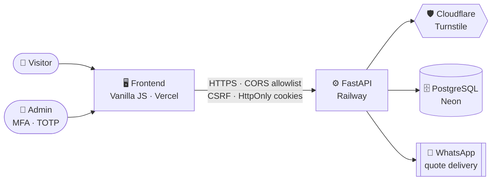

<div align="center">


<a href="https://github.com/">
  
</a>

<br/><br/>


<br/><br/>

<a href="#-what-this-is">What it is</a> &nbsp;•&nbsp;
<a href="#-features">Features</a> &nbsp;•&nbsp;
<a href="#-architecture">Architecture</a> &nbsp;•&nbsp;
<a href="#-security">Security</a> &nbsp;•&nbsp;
<a href="#-testing--migrations">Testing</a> &nbsp;•&nbsp;
<a href="#-tech-stack">Stack</a> &nbsp;•&nbsp;
<a href="#-project-structure">Structure</a> &nbsp;•&nbsp;
<a href="#-changelog">Changelog</a>

</div>

<br/>

<table align="center">
  <tr>
    <td width="170" align="center" valign="middle">
      
    </td>
    <td valign="middle">
      <p align="justify">
        A <b>bilingual (PT/EN) portfolio and client quote-request site</b> with a fully custom
        <b>authenticated admin panel</b>, built to showcase Full Stack Python development in
        production: <b>FastAPI backend</b>, <b>vanilla JS frontend</b>, no frameworks, no
        shortcuts on security.
      </p>
    </td>
  </tr>
</table>

<br/>

## 🧭 What this is

This repository is the engine behind my personal portfolio — and it's built to do more than sit still and look nice. It's a small, real, production-grade **product**:

> [!IMPORTANT]
> **A visitor lands on the site, requests a project quote in their own language, and it lands straight on my WhatsApp — while I manage every word, image, and project on the site from a private, MFA-protected dashboard, without ever touching a line of code.**

Everything here — backend, frontend, security, deployment — was designed and built end-to-end by me. Nothing was templated. Nothing was skipped.

<br/>

## ✨ Features

### 🌐 Public site

<table>
  <tr>
    <td width="60" align="center">🇧🇷🇺🇸</td>
    <td><b>Full PT/EN bilingual support</b><br/>Every string, on every page (including admin), switches instantly with zero reload.</td>
  </tr>
  <tr>
    <td align="center">🌗</td>
    <td><b>Dark / Light theme toggle</b><br/>Remembered across visits.</td>
  </tr>
  <tr>
    <td align="center">🎌</td>
    <td><b>Animated Brazil/USA flag GIFs</b><br/>Woven into the hero background — a visual signature of my dual cultural and professional focus.</td>
  </tr>
  <tr>
    <td align="center">🧭</td>
    <td><b>Professional Experience timeline</b><br/>Company, role, period, and description, fully managed from the admin dashboard.</td>
  </tr>
  <tr>
    <td align="center">💬</td>
    <td><b>"Request a Quote" contact form</b><br/>Messages are delivered straight to WhatsApp, shielded by Cloudflare Turnstile and rate limiting.</td>
  </tr>
  <tr>
    <td align="center">🛡️</td>
    <td><b>Live support chat widget</b><br/>Protected by the same <b>anti-fraud layer</b> as the rest of the site: Turnstile verification, per-IP rate limiting, and admin-side IP blocking for abusive visitors.</td>
  </tr>
  <tr>
    <td align="center">📄</td>
    <td><b>Custom 404 page</b><br/>With its own lightweight language toggle.</td>
  </tr>
  <tr>
    <td align="center">🎨</td>
    <td><b>Deliberate motion design</b><br/>3D tilt on project cards, an animated scroll-progress "radar", scroll-triggered reveals.</td>
  </tr>
</table>

### 🔐 Admin dashboard

<table>
  <tr>
    <td width="60" align="center">🔑</td>
    <td><b>MFA-protected login (TOTP)</b><br/>Google Authenticator / Authy compatible, with one-time-use encrypted backup codes.</td>
  </tr>
  <tr>
    <td align="center">🗂️</td>
    <td><b>Full CRUD</b><br/>Projects, Skills, and Experience — content updates with zero deploys.</td>
  </tr>
  <tr>
    <td align="center">💬</td>
    <td><b>Chat inbox</b><br/>Reply to visitors in real time, close/reopen conversations, and block a visitor's IP directly from the thread.</td>
  </tr>
  <tr>
    <td align="center">📊</td>
    <td><b>Live stats</b><br/>Project/skill/experience counts, publish status, MFA status — at a glance.</td>
  </tr>
  <tr>
    <td align="center">📱</td>
    <td><b>Responsive layout</b><br/>Mobile-friendly, for managing the site from a phone.</td>
  </tr>
  <tr>
    <td align="center">🌍</td>
    <td><b>Fully bilingual admin UI</b><br/>Matching the public site 1:1.</td>
  </tr>
</table>

<br/>

## 🏗️ Architecture



<br/>

## 🔒 Security

> [!NOTE]
> Most portfolio sites don't need this level of hardening. Mine has it anyway, because that's the standard I hold my own code to. This system is under an **active anti-fraud layer**: every public entry point (contact form, support chat, login) is verified, rate-limited, and monitored — abuse gets logged and blocked, not just tolerated.

<table>
  <tr>
    <td width="50%" valign="top">

### 🛡️ Abuse & anti-fraud
- **Anti-fraud on every visitor-facing endpoint** — Cloudflare Turnstile human verification, per-IP rate limiting, and admin-controlled IP blocking on contact and chat.
- **Rate limiting on every authenticated admin route**, not just login — defense-in-depth in case a session is ever compromised.
- **Trusted-proxy IP resolution** — the client IP used for rate limiting and abuse blocking is derived from a fixed, configured number of trusted proxy hops, never taken verbatim from a client-controlled header.
- **`TrustedHostMiddleware`** — rejects requests carrying a forged/unexpected `Host` header.

### 🔑 Authentication & sessions
- **Argon2id** password hashing — the current OWASP-recommended algorithm — with **account lockout** after repeated failed attempts, enforced on *both* the password step and the MFA step.
- **Short-lived JWT access tokens + rotating refresh tokens**, delivered only as `HttpOnly` + `Secure` + `SameSite`-protected cookies — never touchable by client-side JS.
- **Refresh-token reuse detection** — if a rotated/revoked token is ever replayed, the entire token family is revoked and the attempt is logged as a probable theft.
- **Optional TOTP MFA** on the admin account, with encrypted backup codes.
- **TOTP secrets encrypted at rest** (Fernet) — a database leak alone doesn't hand over working MFA codes.

</td>
    <td width="50%" valign="top">

### 🧾 Request integrity
- **CSRF-protected admin actions** — a double-submit token, independent of the session cookie, is required on every mutating admin request.
- **CSRF protection extends to the visitor chat** — a double-submit token, independent of the `HttpOnly` session cookie, is required on every message sent, closing the gap a cross-origin `SameSite=None` cookie would otherwise leave open.
- **Strict, allowlist-only CORS** — no wildcard origins, ever.
- **Full security header suite** on every response: a **`script-src` CSP with no `unsafe-inline`**, `Strict-Transport-Security` (HSTS), `X-Content-Type-Options: nosniff`, `X-Frame-Options: DENY` + `frame-ancestors 'none'` (clickjacking-proof), `Referrer-Policy`, `Permissions-Policy`.

### 🗄️ Data & internals
- **Zero raw SQL** — 100% SQLAlchemy ORM / parameterized queries, immune to SQL injection by construction.
- **SSRF-hardened URL validation** on every user-supplied link field — blocks `localhost`, private, link-local, and reserved IP ranges before they're ever accepted.
- **PII data minimization** — visitor IP addresses on contact messages and chat conversations are automatically purged after a configurable retention window.
- **No internal errors ever reach the client** — everything is logged server-side and returned as a safe, generic message.
- **Race-condition-safe by design** — refresh-token rotation, TOTP/backup-code consumption, and chat cooldown/message-cap enforcement are all atomic, single-statement DB operations; concurrent requests can never double-spend the same one-time action.
- **Ongoing dependency hygiene** via Dependabot (with cooldown windows) and periodic manual security audits.

</td>
  </tr>
</table>

<br/>

## 🧪 Testing & migrations

| | |
|---|---|
| ✅ | Automated **security and concurrency test suite** (`pytest`) — covers CSRF enforcement, TOTP/backup-code replay protection, and race conditions under concurrent load. |
| 🔍 | **`pip-audit`** dependency vulnerability scanning in CI. |
| 🗃️ | **Alembic**-managed database schema — every schema change is a reviewable, reversible migration. |

<br/>

## 🛠️ Tech stack

<p>
  
  
  
  
  
  
  
  
  
  
  
</p>

> **No frontend framework. No build step.** Pure HTML/CSS/JavaScript — fast, dependency-free, and entirely under my control.

<br/>

## 📁 Project structure

```text
portfolio/
├── backend/
│   ├── alembic/             # versioned DB schema migrations
│   ├── app/
│   │   ├── api/routes/      # auth, contact, projects, skills, experiences, chat
│   │   ├── core/            # config, security, middleware, Turnstile, logging
│   │   ├── models/          # SQLAlchemy models
│   │   ├── schemas/         # Pydantic validation schemas
│   │   └── services/        # business logic
│   └── tests/               # security & concurrency test suite (pytest)
└── frontend/
    ├── index.html           # public site
    ├── 404.html
    └── assets/              # CSS, JS, i18n, images
```

*The authenticated admin panel lives under its own private route — intentionally not linked from the public site.*

<br/>

## 📜 Changelog

### 🛠️ Hardening, performance & cleanup — `21/10/2026`

> A full audit pass over the codebase: six parts, covering bug fixes, measurable performance gains, and dead-code removal. Benchmarks use the same workload before and after (300 conversations, 6,000 messages, 2,000 blocked IPs).

<details open>
<summary><b>🐛 Bugs fixed</b></summary>
<br/>

| | |
|---|---|
| 🌐 | **Single, trusted client-IP resolver** — login, contact, and admin rate limits used an IP the client could forge via `X-Forwarded-For`, allowing limit bypass and fake IPs in logs. Now one limiter computes the IP using trusted proxies only, and `--forwarded-allow-ips='*'` was removed from the `Procfile`. |
| 🔑 | **MFA flow** — a wrong code used to redirect back to login, so users never saw "invalid code". The error now shows on screen and the MFA flow is preserved. |
| 🧾 | **Chat CSRF token** — the chat did not return `csrf_token` when starting a conversation, so the widget used a stale token or requested a new one. The token is now returned in the response. |
| 🍪 | **Duplicate cookies** — chat sent 3 `Set-Cookie` headers on start, with CSRF set twice. Now exactly one `Set-Cookie` per cookie. |
| 🎨 | **Skills empty state** — showed the projects icon (same-named function defined in two files). Each section now uses its own icon. |
| 🔗 | **URL validator** — a weaker copy in projects overrode the shared one. Now only the shared validator is used. |

</details>

<details open>
<summary><b>⚡ Performance</b></summary>
<br/>

| Metric | Before | After |
|---|---|---|
| `GET /admin/conversations` (dashboard, every 6 s) | 6.4–8.6 ms | 4.0–4.8 ms **(−40%)** |
| Delete conversation | 4 queries, 5.1–5.9 ms | 2 queries, 2.8–3.3 ms **(−45%)** |
| Memory at startup | 86.0 MB | 81.5 MB |
| Project images (3 projects) | 1,013 KB | 115 KB **(−89%)** |
| Public JS | 83.2 KB | 79.1 KB |
| Polling with tab hidden (dashboard / chat) | 22 / 15 per minute | **0** |
| API calls on reload within 30 s | 3 | **0** (browser cache) |
| Unbounded listings | unlimited | max 200 rows |
| Possible connections to Neon | up to 15 | up to 5 |

> [!NOTE]
> Public endpoints didn't get faster server-side (~3 ms before and after) — the gain comes from caching.

</details>

<details>
<summary><b>🧹 Cleanup</b></summary>
<br/>

- 🗑️ **Removed:** `models/chat.py` (broken copy of the schemas), 5 one-off migration scripts already covered by Alembic, `get_current_admin_ws`, `ChatCsrfTokenResponse`, the duplicated `verify_chat_csrf` function, 216 dead lines from `api.js`, and unused imports.

</details>

<br/>

<div align="center">

<table>
  <tr>
    <td width="80" align="center" valign="middle">
      
    </td>
    <td align="center" valign="middle">
      &nbsp;&nbsp;<b>Built in Brazil</b> &nbsp;·&nbsp; <b>Shipped Worldwide</b>&nbsp;&nbsp;
    </td>
    <td width="100" align="center" valign="middle">
      
    </td>
  </tr>
</table>


</div>